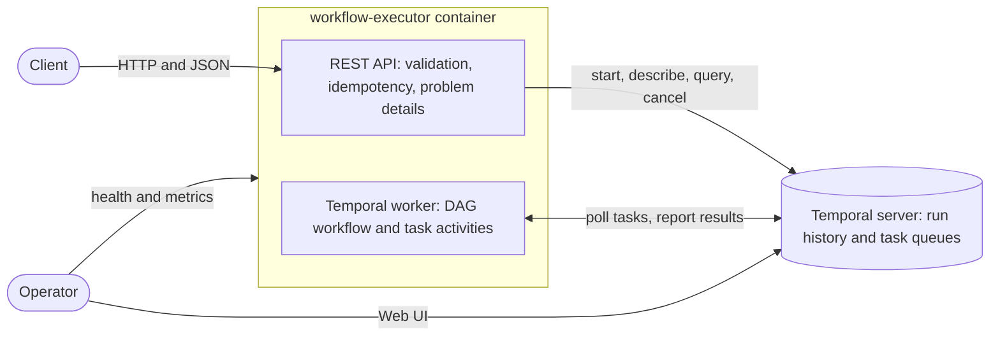

# Workflow Executor

Workflow Executor is an HTTP service that runs workflows. A client submits a definition made of steps and the
dependencies between them. The service starts each step as soon as all of its dependencies have succeeded, so
independent steps run in parallel. A failing step is retried with backoff. When it still fails, the steps that
depend on it are skipped and the rest of the workflow carries on.

Runs execute on [Temporal](https://temporal.io), a durable execution engine. Temporal records every decision a
run makes, so a run continues where it stopped after the service crashes or restarts.

This repository is my answer to a backend engineering exercise (option 3, workflow executor).

## Contents

- [Quick start](#quick-start)
- [Try it](#try-it)
- [Run the tests](#run-the-tests)
- [How it works](#how-it-works)
- [API at a glance](#api-at-a-glance)
- [Configuration](#configuration)
- [Operating the service](#operating-the-service)
- [Decisions and tradeoffs](#decisions-and-tradeoffs)
- [Assumptions](#assumptions)
- [Left out on purpose](#left-out-on-purpose)
- [Next steps](#next-steps)
- [How I built it](#how-i-built-it)

More detail lives in [docs/design.md](docs/design.md) (architecture, state machines, failure behaviour) and
[docs/api.md](docs/api.md) (the full API contract).

## Quick start

To run the service you need only Docker with Compose v2: the image build compiles the code.

```bash
docker compose up --build
```

The first build downloads the base images and the Maven dependencies, so it can take several minutes on a slow
connection; later builds reuse them. When both containers report healthy:

| What | Where |
|---|---|
| API: `POST` a definition here, see [Try it](#try-it) | `http://localhost:8080/api/v1/workflow-runs` |
| Swagger UI | http://localhost:8080/swagger-ui.html |
| OpenAPI document | http://localhost:8080/v3/api-docs |
| Temporal Web UI (every run, its history and its activities) | http://localhost:8233 |
| Health | http://localhost:8080/actuator/health |

If a port is taken, override it: `APP_PORT=8081 TEMPORAL_PORT=7234 TEMPORAL_UI_PORT=8234 docker compose up --build`.

| To | Run |
|---|---|
| Stop, keeping the run history | `docker compose down` |
| Reset, deleting every run | `docker compose down --volumes` |
| Follow the service logs | `docker compose logs --follow app` |

## Try it

The [examples](examples) folder holds one definition per scenario. Run the commands from the repository root.
They use `curl`, and step 6 also uses `jq`; pipe any response into `jq` to pretty-print it.

**1. Submit a run.** Steps `charge-card` and `reserve-stock` both depend only on `validate-order`, so they run in
parallel. `fraud-hold` is a delay step: it waits three seconds on a durable timer.

```bash
curl -i -X POST localhost:8080/api/v1/workflow-runs \
  -H 'Content-Type: application/json' \
  -H 'Idempotency-Key: order-1001' \
  -d @examples/order-fulfilment.json
```

The service answers `202 Accepted` with the run, every step `PENDING`, and a `Location` header to follow. The
run id is derived from the `Idempotency-Key`, so your run gets the same id as this one:

```text
HTTP/1.1 202
Location: http://localhost:8080/api/v1/workflow-runs/18601ed1-a729-355b-82dc-e7eeb1b2816c
X-Request-Id: 92cda76e-1e3f-4e26-aee4-f0c76f710cc1
```

**2. Follow it.** A few seconds later every step has succeeded. Each step shows its attempts and timing
(shortened here to the first two of five steps):

```bash
curl localhost:8080/api/v1/workflow-runs/18601ed1-a729-355b-82dc-e7eeb1b2816c
```

```json
{
  "id": "18601ed1-a729-355b-82dc-e7eeb1b2816c",
  "name": "order-fulfilment",
  "status": "SUCCEEDED",
  "createdAt": "2026-11-06T21:08:47.665Z",
  "closedAt": "2026-11-06T21:08:51.696Z",
  "steps": [
    { "id": "validate-order", "type": "task", "dependsOn": [], "status": "SUCCEEDED", "attempts": 1,
      "startedAt": "2026-11-06T21:08:47.683Z", "finishedAt": "2026-11-06T21:08:47.760Z" },
    { "id": "charge-card", "type": "task", "dependsOn": ["validate-order"], "status": "SUCCEEDED", "attempts": 1,
      "startedAt": "2026-11-06T21:08:47.760Z", "finishedAt": "2026-11-06T21:08:48.621Z" }
  ]
}
```

**3. Repeat the request.** The same `Idempotency-Key` with the same body returns the original run with
`200 OK` and `Idempotent-Replayed: true`; no second run starts. The same key with a different body is rejected:

```bash
curl -X POST localhost:8080/api/v1/workflow-runs -H 'Content-Type: application/json' \
  -H 'Idempotency-Key: order-1001' -H 'X-Request-Id: readme-reuse' -d @examples/flaky-step.json
```

```json
{
  "type": "urn:workflow-executor:problem:idempotency-key-reused",
  "title": "Idempotency-Key reused with a different request",
  "status": 422,
  "detail": "This Idempotency-Key was already used for a different request",
  "instance": "/api/v1/workflow-runs",
  "requestId": "readme-reuse"
}
```

**4. Watch retries.** In `flaky-step.json` the first two attempts of `charge-card` fail with a retryable error.
The step ends `SUCCEEDED` with `"attempts": 3`.

```bash
curl -X POST localhost:8080/api/v1/workflow-runs -H 'Content-Type: application/json' -d @examples/flaky-step.json
```

**5. Watch a failure propagate.** In `failing-step.json`, `charge-card` fails with a non-retryable error. Everything
downstream of it is skipped, while `write-audit-log`, which does not depend on it, still runs. The run ends
`FAILED` (shortened to the fields that matter here):

```json
{
  "status": "FAILED",
  "steps": [
    { "id": "validate-order", "status": "SUCCEEDED", "attempts": 1 },
    { "id": "charge-card", "status": "FAILED", "attempts": 1,
      "failure": { "type": "SimulatedPermanentFailure", "message": "Simulated permanent failure",
                   "retryState": "NON_RETRYABLE_FAILURE" } },
    { "id": "ship", "status": "SKIPPED", "statusReason": "Dependency 'charge-card' finished as FAILED" },
    { "id": "send-invoice", "status": "SKIPPED", "statusReason": "Dependency 'ship' finished as SKIPPED" },
    { "id": "write-audit-log", "status": "SUCCEEDED", "attempts": 1 }
  ]
}
```

`timeout.json` shows a step whose attempts run longer than their timeout: it fails with `"type": "Timeout"` after
two attempts.

**6. Cancel a run.** `long-running.json` waits ten minutes before its second step. Cancel it:

```bash
RUN=$(curl -s -X POST localhost:8080/api/v1/workflow-runs -H 'Content-Type: application/json' \
  -d @examples/long-running.json | jq -r .id)
curl -i -X POST localhost:8080/api/v1/workflow-runs/$RUN/cancel
```

The service answers `202 Accepted`. Moments later the run is `CANCELLED`: the waiting step is cancelled while
running, and the step after it is cancelled before it starts. Cancelling again returns `200`; cancelling a run
that already finished returns `409`.

**7. Send an invalid definition.** The service reports every problem at once, each with the path of the field.
The `X-Request-Id` you send comes back in the body, so a client can quote it when reporting a problem:

```bash
curl -X POST localhost:8080/api/v1/workflow-runs -H 'Content-Type: application/json' \
  -H 'X-Request-Id: readme-invalid' -d @examples/invalid.json
```

```json
{
  "type": "urn:workflow-executor:problem:invalid-definition",
  "title": "Invalid workflow definition",
  "status": 400,
  "detail": "The workflow definition breaks one or more rules",
  "instance": "/api/v1/workflow-runs",
  "errors": [
    { "field": "steps[3].type", "code": "UNSUPPORTED_STEP_TYPE",
      "message": "Unsupported step type 'email'; supported types are: task, delay" },
    { "field": "steps[1].dependsOn[1]", "code": "UNKNOWN_DEPENDENCY",
      "message": "Step 'b' depends on unknown step 'missing'" },
    { "field": "steps", "code": "DEPENDENCY_CYCLE",
      "message": "Steps depend on each other in a cycle: a -> c -> b -> a (each step depends on the next)" }
  ],
  "requestId": "readme-invalid"
}
```

Open the Temporal Web UI at http://localhost:8233 to see the same runs from the engine's side: the event history
of each run, and every activity labelled with its step id. Start runs through the API rather than the UI's Start
Workflow form: the API validates the definition, applies the idempotency rules and freezes the defaults, and a
run started by hand skips all three.

## Run the tests

With JDK 25:

```bash
./mvnw verify
```

Without a local JDK, run the same build in a container:

```bash
docker run --rm -v "$PWD":/workspace -w /workspace eclipse-temurin:25-jdk ./mvnw verify
```

The suite needs no running infrastructure. Temporal's in-memory test server stands in for the real one and skips
timers, so a ten-minute delay finishes instantly.

| Test class | What it proves |
|---|---|
| `DependencyGraphTest` | Execution order and cycle detection |
| `DefinitionValidatorTest` | Every graph rule, including delays that cannot fit within the execution timeout, and that all violations are reported together |
| `DefinitionMapperTest` | Server defaults are resolved at submission |
| `DagWorkflowTest` | Order, parallelism, retries, timeouts, skip propagation, durable timers, cancellation of a running task, of steps running in parallel and of a run that has not begun, and a replay check that fails on non-deterministic workflow code |
| `ReplayCompatibilityTest` | Histories recorded with the first version, checked into the repository, still replay: a change that would break runs in flight fails here |
| `WorkflowRunServiceTest` | Idempotent submission, including eight concurrent requests with one key, reading runs back, cancellation, and how timed-out and terminated runs show their steps |
| `RequestFingerprintsTest` | The idempotency fingerprint ignores absent and empty values |
| `WorkflowRunControllerTest` | Every status code and header of the HTTP contract, and the problem body for each error |
| `WorkflowExecutorApplicationTests` | The full context, worker included, starts without Temporal, publishes its OpenAPI document, reports live but not ready, answers 503 within seconds and rejects oversized bodies with 413 |
| `ExecutorPropertiesTest` | Invalid configuration stops the application at startup, naming the property |
| `ArchitectureTest` | Packages have no cycles and depend inwards, the definition rules are plain Java, and workflow code calls none of the wall-clock, thread or random APIs that break Temporal's replay |

## How it works



1. The API validates the definition in two passes: field rules (types, sizes, ranges) and graph rules (unknown
   or duplicate dependencies, duplicate ids, cycles). It resolves every default and freezes the result as the
   workflow input, so later configuration changes never alter a run that has started.
2. The API starts one Temporal workflow per run. The run id is the workflow id. With an `Idempotency-Key`, the
   run id is a UUID derived from the key, so a repeated request maps to the same workflow id and Temporal
   rejects the duplicate start.
3. The worker executes the workflow. It starts every step whose dependencies have all succeeded and waits for
   any of them to finish. A task step is a Temporal activity with a per-attempt timeout, a heartbeat and a
   retry policy. A delay step is a durable timer. A step whose dependency did not succeed is skipped.
4. `GET` reads the run's status from Temporal and the state of each step from the workflow's `progress` query.

Temporal's history is the only store. The service has no database of its own, so it never has to keep two
stores consistent. [docs/design.md](docs/design.md) covers the flows, the state machines, consistency boundaries
and behaviour under failure.

## API at a glance

| Method and path | Purpose | Success |
|---|---|---|
| `POST /api/v1/workflow-runs` | Validate a definition and start a run | `202`, or `200` for an idempotent replay |
| `GET /api/v1/workflow-runs/{runId}` | Read a run and the state of every step | `200` |
| `POST /api/v1/workflow-runs/{runId}/cancel` | Cancel a run | `202`, or `200` if already cancelled |

Errors use RFC 9457 problem details with a stable `type` URN, the `requestId`, and for invalid input an
`errors` list with the path of each field. The contract, every field, limit and problem type is in
[docs/api.md](docs/api.md). The running service also describes itself in Swagger UI.

## Configuration

Settings live in [application.yml](src/main/resources/application.yml) and are validated at startup: an invalid
value stops the application instead of failing later. The ones you are likely to change:

| Environment variable | Default | Meaning |
|---|---|---|
| `TEMPORAL_TARGET` | `localhost:7233` | Temporal frontend address (`temporal:7233` in Compose) |
| `TEMPORAL_NAMESPACE` | `default` | Temporal namespace |
| `TEMPORAL_TASK_QUEUE` | `workflow-executor` | Task queue shared by the API and the workers |
| `TEMPORAL_WORKER_ENABLED` | `true` | `false` gives an API-only instance |

Other settings, under `workflow-executor.*`: the run execution timeout (24 hours), the API's call timeout towards
Temporal (5 seconds), the progress query timeout (5 seconds), and the defaults for task steps (3 attempts,
30-second attempt timeout, backoff from 1 second doubling up to 30 seconds).

## Operating the service

- **Health.** `/actuator/health/liveness` says whether the process works. `/actuator/health/readiness` also
  checks Temporal: when Temporal is unreachable the instance reports not ready, so it stops receiving traffic,
  but it stays alive, because a restart would not help. The container health check uses readiness.
- **Logs.** Every line carries `req=<request id>`, `run=<run id>` and `step=<step id>` when they apply. The
  request id comes from the caller's `X-Request-Id` or is generated, and comes back in the response and in every
  error body. The run id ties the API request to the workflow and activity log lines that executed it.
- **Metrics.** `/actuator/prometheus` exposes JVM and HTTP metrics plus the Temporal SDK's metrics. The
  schedule-to-start latency of workflow and activity tasks is the backlog signal: when it grows, add workers.
- **Temporal Web UI.** Shows every run, its full event history, pending activities with their current attempt
  and last failure, and lets an operator terminate or reset a run.
- **When Temporal is down.** API calls answer `503` with `Retry-After` within about five seconds; readiness turns
  down. Runs already started resume when Temporal is back. Workers resume polling within about a minute. The
  service also starts while Temporal is down: the worker connects in the background once Temporal is reachable.
- **When no worker is up.** Submissions still succeed and the run waits in the task queue. Reads answer `503`,
  because the progress query needs a worker; they recover when a worker returns.
- **Scaling.** API instances are stateless. Workers scale horizontally on the task queue; Temporal distributes
  the work. `TEMPORAL_WORKER_ENABLED=false` runs API-only instances, so the two can scale separately.

## Decisions and tradeoffs

- **Temporal as the execution engine.** Durable state, retries with backoff, timeouts, timers and cancellation
  are the hard part of a workflow executor, and Temporal provides them with an audited history of every run.
  I spent the time on what the exercise asks about instead: the definition contract, validation, failure
  semantics, idempotency and inspection. The cost is one more piece of infrastructure, and workflow code must
  stay deterministic. The replay test guards that rule.
- **No database of my own.** Temporal's history is the single source of truth, so there is no dual write between
  a database and the engine, and no outbox. Starting a run is one atomic call. The cost is that reads depend on
  Temporal and, for step detail, on a worker.
- **Step state from a query.** The workflow answers a `progress` query from its own state, so the read model
  can never drift from what actually ran. A query needs a worker; a projection written to a read store would
  remove that dependency at the cost of eventual consistency.
- **Cancellation that tells the truth.** A running task is asked to stop through its heartbeat, and its step
  becomes `CANCELLED` only once the task has stopped; the run ends only after every running step has stopped.
  A task that finishes before it notices keeps its real outcome. Cancelling therefore takes up to a few seconds,
  which is why the API answers `202`. Temporal records a run as cancelled once cancellation was requested, so a
  request that arrives while the last steps are finishing still ends the run as `CANCELLED`, with those steps in
  their real final state.
- **Failure policy: continue independent branches.** When a step fails, its dependents are skipped, and steps
  that do not depend on it still run. This gives the most complete result and the clearest picture of what
  failed. Some workflows want fail-fast instead; that would be a per-definition option.
- **Idempotency without storage.** The key maps to a name-based UUID, Temporal rejects a second start with the
  same workflow id even after the first run has finished, and a SHA-256 fingerprint of the request, stored in
  the run's memo, separates a replay from a key reused for a different request. Keys are remembered for as long
  as Temporal retains the run: 24 hours on the local development server.
- **Two Temporal clients.** The API's client gives up after five seconds, so callers get a fast `503` instead of
  waiting through the SDK's one-minute retry window. The worker's client keeps that longer window, so a short
  Temporal outage does not lose activity results.
- **One deployable for API and worker.** Simple to run and to review. They are separable by configuration.
- **Strict request parsing.** Unknown JSON fields are rejected, so a typo such as `dependOn` fails loudly
  instead of silently dropping a dependency.
- **Contract limits are constants.** Limits such as 100 steps per definition are part of the API contract, so
  they are code, not configuration: a definition accepted by one environment is accepted by every other.

## Assumptions

- A definition is submitted together with its run. There is no separate registry of reusable definitions.
- Tasks are simulated. A task step sleeps for its simulated work time and fails on demand; the `simulate` block
  exists only to exercise retries, timeouts and failures. A real task type would replace the simulated activity.
- Steps do not pass data to each other. Dependencies express order only.
- Task handlers will be idempotent. Temporal runs an activity at least once, so each invocation carries a stable
  idempotency key (`<runId>:<stepId>`) for a real handler to deduplicate side effects.
- The service runs behind a gateway that terminates TLS, authenticates callers and applies rate limits.

## Left out on purpose

- **Authentication and authorisation.** Every caller can read and cancel every run. With authentication,
  idempotency keys and run access would be scoped per client.
- **Listing and searching runs.** The Temporal Web UI covers this for operators; an API endpoint would use
  Temporal's visibility queries.
- **Manual retry of a failed run.** Today a client resubmits the definition with a new key, which runs every
  step again. See next steps.
- **Real task types** such as HTTP calls, and passing outputs between steps.
- **Rate limiting.** Assumed at the gateway. The service guards its own memory: it rejects request bodies over
  1 MB, bounds every list in a definition and lists at most 100 violations.
- **A production Temporal setup.** Compose runs Temporal's single-binary development server with SQLite.
  Production would use a Temporal cluster with PostgreSQL or Cassandra, or Temporal Cloud.

## Next steps

1. Return the final step states as the workflow result, so reads of finished runs come from history and no
   longer need a worker.
2. `POST /workflow-runs/{runId}/retry`: start a linked run that reuses the steps that already succeeded and
   retries only the rest.
3. A `GET /workflow-runs` listing with filters, backed by Temporal visibility queries.
4. A fail-fast failure policy per definition.
5. OpenTelemetry tracing from the HTTP request through the workflow to each activity, with Temporal's tracing
   interceptor.
6. Workflow versioning (`Workflow.getVersion` or worker deployment versioning) before the workflow code changes
   while runs are in flight.
7. Authentication, with idempotency keys scoped per client.

## How I built it

I worked with Claude Code as a pair programmer: I set the scope and direction and reviewed the result, the
assistant proposed the design and wrote most of the code and tests, and every behaviour in this README was
checked against the running stack. Review and testing caught real issues, each now covered by a test:

- With the SDK's default client settings, an API call hung for about a minute when Temporal was down. The fix
  is the separate fail-fast API client described above.
- Temporal accepts a cancellation request for a run that has already finished, without an error. The service
  now checks the run's status again after the request, so a run that finished in between is reported as `409`.
- A read during a worker outage returned `500`. Temporal answers the query with "no poller seen", which now maps
  to `503` with `Retry-After`.
- Spring builds the problem body for framework errors such as `415` after the point where the request id was
  added, so the id was missing. It is now added afterwards.

A second, independent review pass found more, each now fixed and tested:

- With the worker enabled, the service did not start at all while Temporal was down, because the SDK checks
  the namespace before it polls. The worker now connects in the background with backoff.
- A cancelled task could keep running and succeed after its step was reported `CANCELLED`. The workflow now
  waits for every running task to stop.
- A one-hour delay, the largest allowed, could never finish within the then one-hour execution timeout. Such
  definitions are now rejected up front, and the default timeout is 24 hours.
- A failed read after a successful start could answer `503`, tempting a client without a key to submit again.
  Answers to writes now keep the write's outcome.
- The idempotency fingerprint included absent fields, so adding an optional field in a release would have
  broken retries that span the release.
