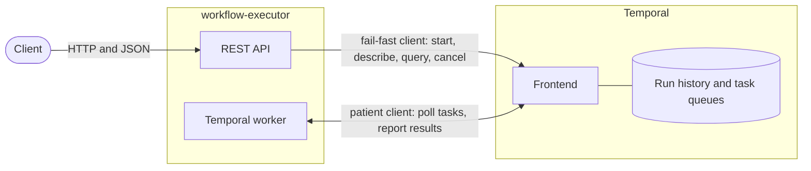
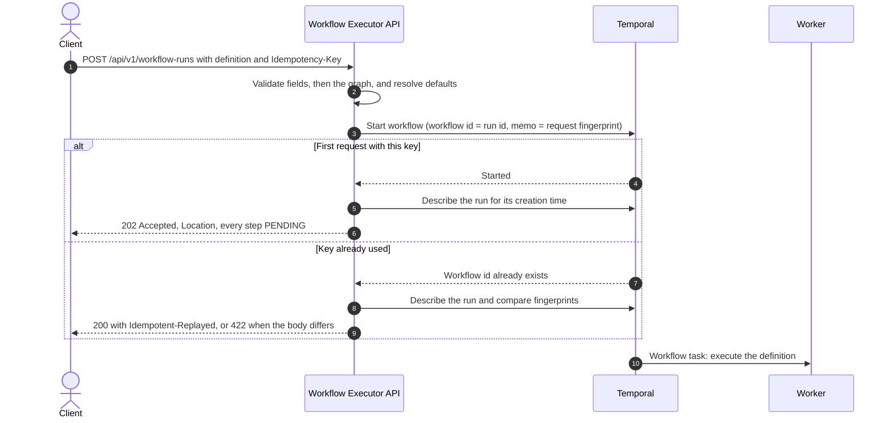
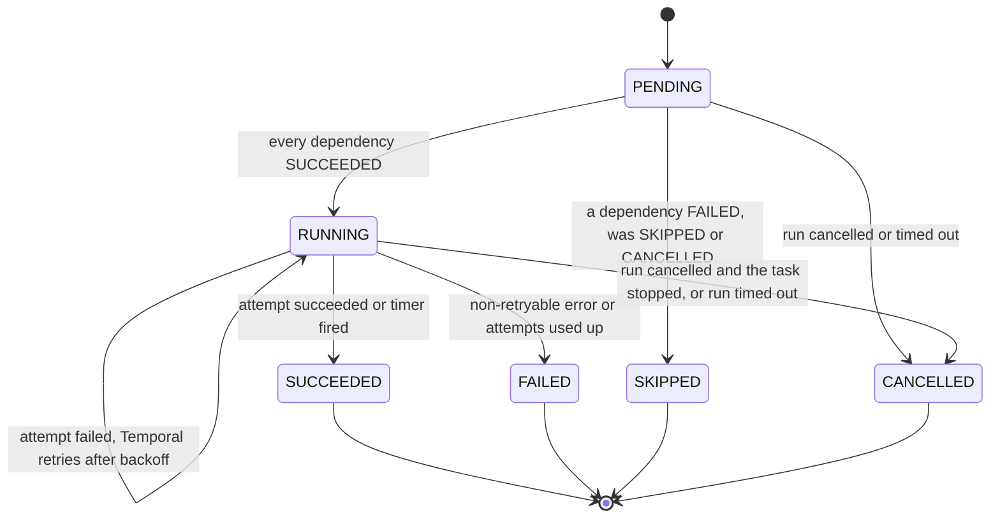
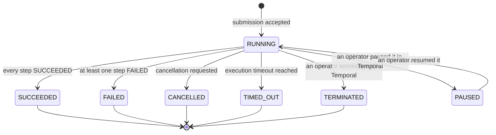

# Design

This document explains how Workflow Executor is built and how it behaves, including under failure. The
[README](../README.md) covers running and operating it; [api.md](api.md) is the API contract.

## Contents

- [Components](#components)
- [Submitting a run](#submitting-a-run)
- [Executing a run](#executing-a-run)
- [Step and run states](#step-and-run-states)
- [Reading a run](#reading-a-run)
- [Cancelling a run](#cancelling-a-run)
- [Idempotency](#idempotency)
- [Consistency boundaries](#consistency-boundaries)
- [Behaviour under failure](#behaviour-under-failure)
- [Determinism and versioning](#determinism-and-versioning)
- [Scaling](#scaling)

## Components

| Component | Responsibility |
|---|---|
| REST API | Validates definitions, applies idempotency, starts, reads and cancels runs, maps every failure to a problem response |
| Temporal worker | Executes the workflow, which schedules steps in dependency order, and the task activities |
| Temporal | Stores each run's event history durably, dispatches tasks to workers, retries activities, fires timers, enforces timeouts |

The API and the worker ship as one deployable and share one task queue. A configuration switch turns the worker
off, which gives an API-only instance; the two then scale independently.

The service starts even when Temporal is down. The worker then connects in the background, retrying with a
backoff of up to 30 seconds, while readiness reports Temporal as down.

The API and the worker talk to Temporal through separate clients with different failure behaviour. The API's
client gives up after a few seconds, so an HTTP caller gets a fast `503` while Temporal is down. The worker's
client keeps the SDK's retry window of about a minute, so a short outage does not lose an activity's result.

## Submitting a run

Validation runs in two passes and both collect every violation before answering:

1. **Field rules**, declared on the request types and published in the OpenAPI document: required fields,
   sizes, ranges, the step id format. Unknown JSON fields are rejected.
2. **Graph rules**, which need the whole definition: supported step types, fields that only apply to one type,
   unique ids, dependencies that exist, no self-dependency, no repeated dependency, no cycle. A cycle is
   reported with the path of the steps that form it. Finally, the delays along every chain of dependencies must
   add up to less than the execution timeout; otherwise the run could never finish.

The API then resolves every default (attempts, timeouts, backoff) and passes the result to Temporal as the
workflow input. The settings a run starts with are frozen in its history: changing the server configuration
later never changes a run that is already in flight, and replaying a run always sees the same input.

## Executing a run

The workflow keeps one state record per step and repeats one loop until no step is in flight:

1. Walk the steps in dependency order, so that every step comes after the steps it depends on. For each
   pending step: if any dependency finished without succeeding, mark the step skipped; if every dependency
   succeeded, start the step. Once the run is cancelled, this walk is skipped, so nothing new starts.
2. Wait until any started step finishes.
3. Record the outcome of every step that finished: succeeded, failed or cancelled.

Walking in dependency order means a skip reaches every transitive dependent in one pass. Steps that become ready
together start together, which is where the parallelism comes from.

When the loop ends, the run completes if every step succeeded. Otherwise it fails with the list of failed
steps. The run fails only after every branch that could still run has finished, so the result is as complete as
possible. A cancelled run likewise ends only once every step in flight has stopped; the steps that never started
are then marked cancelled.

**Task steps** run as Temporal activities with:

- a start-to-close timeout per attempt;
- a heartbeat timeout of a few seconds. The task heartbeats while it works, so a crashed worker is detected
  quickly and the attempt is retried elsewhere. The heartbeat is also how a running task learns about
  cancellation, and the workflow waits for the task to stop before it marks the step cancelled;
- a retry policy with exponential backoff and a maximum number of attempts. A non-retryable error stops
  retrying at once.

Temporal performs the retries. The workflow sees one outcome per step: success with the number of attempts,
or failure with its type, message and the reason Temporal stopped retrying. Only failure types that tasks
declare reach clients; any other error, such as a Java exception, is reported as `UnexpectedError` and its
detail stays in the worker log.

**Delay steps** are durable timers held by Temporal, not sleeping threads. A timer survives worker restarts and
costs nothing while it waits.

Every task invocation carries `<runId>:<stepId>` as an idempotency key, the same across retries, because Temporal
runs an activity at least once.

## Step and run states

A finished step never changes state again. A skipped or cancelled step carries a `statusReason`; a failed step
carries a `failure`. When a run times out, its workflow code never finishes, so the steps still open are shown
as cancelled, with the reason, because they stopped with the run. A run that an operator terminated has no step
detail at all: Temporal's Java SDK cannot rebuild the state of a terminated run for a query.

The run status is Temporal's execution status, so it is correct even for outcomes the workflow code never sees,
such as a termination. The execution timeout is a safety net against runs that never finish. Temporal records a
run as cancelled once a cancellation was requested, whatever the workflow does afterwards, so a request that
arrives while the last steps are finishing still ends the run as `CANCELLED`; those steps keep their real final
state.

## Reading a run

A read makes two calls. Describing the workflow execution gives the run status, the creation and closing times
and the name; it needs only the Temporal server. The `progress` query gives the state of every step; a worker
answers it from the workflow's own state, rebuilt from history if the run is not in its cache.

Reading step state through a query keeps a single source of truth: the read model cannot drift from what the
workflow did. The cost is that step detail needs a running worker. Without one, a read answers `503` until a
worker returns. For finished runs, returning the final step states as the workflow result would remove that
dependency; it is the first item under next steps.

The answer to a write never turns into an error because a read after it failed. If the run has started, or the
cancellation is recorded, the response says so and leaves out what it could not read: the creation time, or the
step states.

## Cancelling a run

```mermaid
sequenceDiagram
    autonumber
    actor Client
    participant API as Workflow Executor API
    participant Temporal
    participant Worker
    Client->>API: POST /api/v1/workflow-runs/{runId}/cancel
    API->>Temporal: Describe the run
    alt Already cancelled
        API-->>Client: 200 OK
    else Already finished otherwise
        API-->>Client: 409 Conflict
    else Running
        API->>Temporal: Request cancellation
        API->>Temporal: Describe again, in case the run finished in between
        API-->>Client: 202 Accepted (409 if it finished in between)
        Temporal->>Worker: Workflow task with the cancellation
        Worker->>Temporal: Cancel timers and ask running tasks to stop
        Temporal-->>Worker: Each task stops at its next heartbeat
        Worker->>Temporal: Once every task has stopped, mark unstarted steps CANCELLED and end the run
    end
```

Temporal accepts a cancellation request for a run that has already finished and simply ignores it. That is why
the API checks the status again after the request.

## Idempotency

A client makes a submission safe to retry by sending an `Idempotency-Key`.

- The key becomes the run id through a name-based UUID, so the same key always maps to the same Temporal
  workflow id.
- The workflow id reuse policy rejects a second start with that id, even after the first run has closed.
  Temporal enforces this atomically, so concurrent duplicates cannot both start a run and there is no
  check-then-act race.
- The SHA-256 fingerprint of the request body is stored in the run's memo when the run starts. A duplicate
  start compares fingerprints: equal means a replay (`200` with the original run), different means the key was
  reused for another request (`422`). The fingerprint covers a canonical form of the request, without absent or
  empty values and with properties in a fixed order, so a retry keeps its fingerprint across a release that adds
  an optional field.
- A key is remembered for as long as Temporal retains the run, which is the namespace retention period.
- Without a key, every request starts a new run.

The key matters most after an unknown outcome. If the API times out or answers `503`, the start may still have
happened. Retrying with the same key returns that run instead of starting a second one.

## Consistency boundaries

| Boundary | Guarantee |
|---|---|
| Starting a run | One atomic call writes the workflow id, the frozen definition and the memo with the fingerprint. A run never exists without its fingerprint. |
| Changing step state | Happens only inside a workflow task. Temporal commits the task's decisions and appends them to the history atomically. |
| Executing a task | At least once. An attempt can run again after a timeout even if its side effects happened; the idempotency key is there to deduplicate them. |
| Reading a run | Status comes from the server and step state from the workflow, so a read can lag the worker by one workflow task. |
| The service itself | Stateless. No database, no cache, no in-memory state that matters for correctness, so any instance can serve any request. |

## Behaviour under failure

| Situation | What happens | What the client sees |
|---|---|---|
| Invalid definition | Nothing starts | `400` listing every violation |
| Delays that cannot fit within the execution timeout | Nothing starts | `400` with `EXCEEDS_EXECUTION_TIMEOUT` |
| Request body over the size limit | Rejected while it is parsed | `413` |
| Same key, same body | No second run | `200`, `Idempotent-Replayed: true`, the original run |
| Concurrent requests with one key | Temporal accepts exactly one start | One `202`, the others `200` |
| Same key, different body | No run starts | `422` |
| Temporal unreachable at submission | Nothing starts | `503` with `Retry-After` within about five seconds |
| Response lost after the run started | The run continues | A retry with the same key gets `200` and the run |
| A read fails right after a write took effect | The write stands | The answer reports the write and leaves out what it could not read |
| Task attempt throws a retryable error | Temporal retries with backoff until attempts are used up | Step stays `RUNNING`, then `SUCCEEDED` or `FAILED` with the attempt count |
| Task attempt exceeds its timeout | Counts as a failed attempt | On final failure, `failure.type` is `Timeout` |
| Task throws a non-retryable error | No more attempts | Step `FAILED`, `retryState` is `NON_RETRYABLE_FAILURE` |
| A step fails for good | Its dependents are skipped; independent branches continue | Run `FAILED` once nothing else can run |
| Worker crashes during an attempt | The missed heartbeat or the attempt timeout fails the attempt; Temporal retries it on any worker | The step may show one more attempt |
| Service restarts during a run | The workflow is rebuilt from history on the next worker | The run continues where it stopped |
| Service starts while Temporal is down | It starts; the worker connects in the background once Temporal is reachable | Readiness reports down until then |
| Temporal restarts | Runs are persisted; workers reconnect within about a minute | Calls during the outage get `503`; readiness reports down |
| No worker running | Submitted runs wait in the task queue | `POST` succeeds; `GET` answers `503` until a worker returns |
| A run exceeds the execution timeout | Temporal stops it | Run `TIMED_OUT`; open steps `CANCELLED` with the reason |
| Cancellation | Timers stop at once, running tasks at their next heartbeat; pending steps never start | `202`, then run `CANCELLED` |
| A task finishes before it notices a cancellation | Its real outcome is kept; the run still ends cancelled | That step shows `SUCCEEDED` or `FAILED`, the run `CANCELLED` |
| Cancellation reaches a run that just finished | Temporal ignores it | `409` |

## Determinism and versioning

Temporal rebuilds a workflow's state by replaying its history through the workflow code, so that code must make
the same decisions every time. The workflow follows these rules:

- time comes from Temporal's workflow clock, and waiting goes through Temporal timers and promises, never
  through threads or sleeps;
- collections are iterated in a fixed order;
- configuration reaches the workflow only through its input, which is frozen at submission;
- logging uses Temporal's replay-aware logger, so a replay does not log twice.

Two tests protect this. One records the histories of workflows covering every outcome and replays them
against the same code, which catches non-deterministic code. The other replays histories recorded with the
first version and checked into the repository, which catches a change that would break runs already in flight.

The workflow type, the activity type and the query have fixed names, so renaming a class never breaks a run in
flight. Changing the workflow's logic while runs are in flight needs Temporal's versioning; that is listed under
next steps, because no released version exists yet.

## Scaling

- API instances hold no state, so they scale horizontally behind a load balancer.
- Workers scale horizontally on the task queue. Temporal hands each task to one worker and moves work away from
  a worker that stops heartbeating.
- A run's steps run in parallel across all workers, because each activity is an independent task.
- Temporal itself scales as a cluster or as Temporal Cloud. The development server in Compose is a single
  process with an SQLite file and is meant for local use only.
- The schedule-to-start latency in the Temporal SDK metrics shows when tasks wait for workers, which is the
  signal to add workers.
